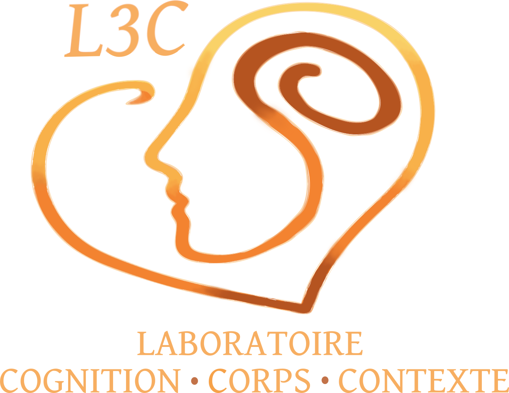

::: {.hero}
::: {.hero-texte}

Université du Québec à Trois-Rivières

<h1>Understanding cognition through the body and its context</h1>

The **Cognition-Body-Context Laboratory (L3C)**, directed by Guillaume T. Vallet, Ph.D., studies human psychology through an embodied and situated approach to cognition.
:::

::: {.hero-logo}
{fig-alt="L3C logo: a face profile and a spiral drawn inside a heart."}
:::
:::



::: {.accueil}

## Our approach

Cognitive functioning is intrinsically shaped by the interactions between a person and their environment. Bodily characteristics (sensory and motor abilities, physiognomy), physiological state (fatigue, energy), the immediate environment (lighting, noise) and the social context (culture, stereotypes) all shape thoughts and information-processing abilities.

## Research themes

::: {.themes}
::: {.theme}
#### Memory and aging
Cognitive aging in healthy adults and in people with cognitive impairments.
:::

::: {.theme}
#### Neurocognitive disorders
Assessing and understanding dementia and neurocognitive disorders.
:::

::: {.theme}
#### Heart and cognition
Cardiovascular adaptation as a marker of cognitive functioning and a lever for non-pharmacological intervention.
:::

::: {.theme}
#### Ageism and retirement
Representations of age and the effect of retirement on cognition.
:::
:::

## Our values

The lab stands for **respect**, **openness** and **rigour**. Its research follows ethical and integrity standards, and its findings are shared openly and accessibly with both the scientific community and the general public. Some studies aim for direct application, with concrete social benefits.

Collaboration is just as essential, within the team and with colleagues here and abroad. The lab fosters an inclusive environment where diverse ideas are encouraged and every person is respected.

## Recent publications



[All publications →](publications.qmd){.lien-suite}

## Contact {#contact}

**Cognition-Body-Context Laboratory (L3C)**\
Department of Psychology, Université du Québec à Trois-Rivières\
3600, rue Sainte-Marguerite, Trois-Rivières (Québec) G9A 5H7, Canada\
[l3c@uqtr.ca](mailto:l3c@uqtr.ca)

:::
