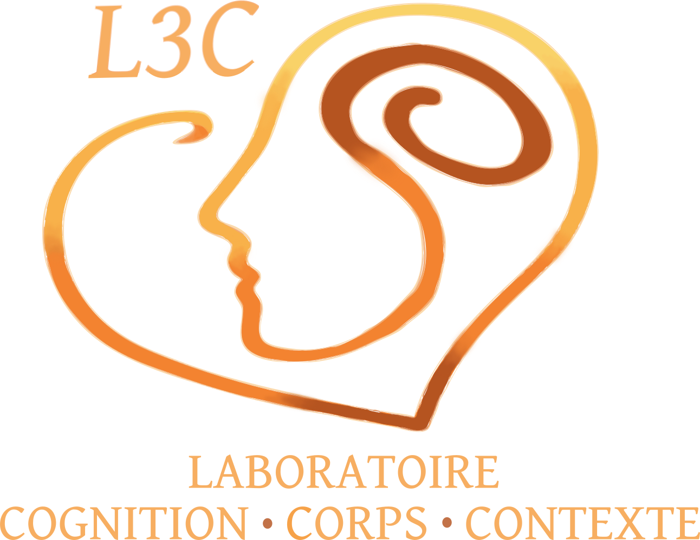

::: {.hero}
::: {.hero-texte}

Université du Québec à Trois-Rivières

<h1>Comprendre la cognition à partir du corps et du contexte</h1>

Le **Laboratoire Cognition-Corps-Contexte (L3C)**, dirigé par Guillaume T. Vallet, Ph.D., étudie la psychologie humaine selon une approche incarnée et située de la cognition.
:::

::: {.hero-logo}
{fig-alt="Logo du Laboratoire Cognition-Corps-Contexte : un profil de visage et une spirale dessinés dans un cœur."}
:::
:::



::: {.accueil}

## Notre approche

Le fonctionnement cognitif est intrinsèquement déterminé par les interactions entre une personne et son environnement. Les caractéristiques corporelles (capacités sensorielles et motrices, physionomie), l'état physiologique (fatigue, énergie), l'environnement immédiat (luminosité, bruit) et le contexte social (culture, stéréotypes) façonnent les pensées et les capacités de traitement de l'information.

## Thématiques de recherche

::: {.themes}
::: {.theme}
#### Mémoire et vieillissement
Le vieillissement cognitif chez les adultes en santé et les personnes présentant des troubles cognitifs.
:::

::: {.theme}
#### Troubles neurocognitifs
L'évaluation et la compréhension des démences et des troubles neurocognitifs.
:::

::: {.theme}
#### Cœur et cognition
L'adaptation cardiovasculaire comme marqueur du fonctionnement cognitif et levier d'intervention non pharmaceutique.
:::

::: {.theme}
#### Âgisme et retraite
Les représentations de l'âge et l'effet du passage à la retraite sur la cognition.
:::
:::

## Nos valeurs

Le laboratoire prône le **respect**, l'**ouverture** et la **rigueur**. Ses recherches s'inscrivent dans une démarche éthique et intègre, et leurs résultats sont diffusés à la fois auprès de la communauté scientifique et du grand public, de manière ouverte et accessible. Une partie des études vise une application directe, avec des retombées sociales concrètes.

La collaboration est tout aussi essentielle, au sein de l'équipe comme avec des collègues d'ici et d'ailleurs. Le laboratoire cultive un environnement inclusif, où la diversité des idées est encouragée et celle des personnes respectée.

## Publications récentes



[Toutes les publications →](publications.qmd){.lien-suite}

## Nous joindre {#contact}

**Laboratoire Cognition-Corps-Contexte**\
Département de psychologie, Université du Québec à Trois-Rivières\
3600, rue Sainte-Marguerite, Trois-Rivières (Québec) G9A 5H7\
[l3c@uqtr.ca](mailto:l3c@uqtr.ca)

:::
